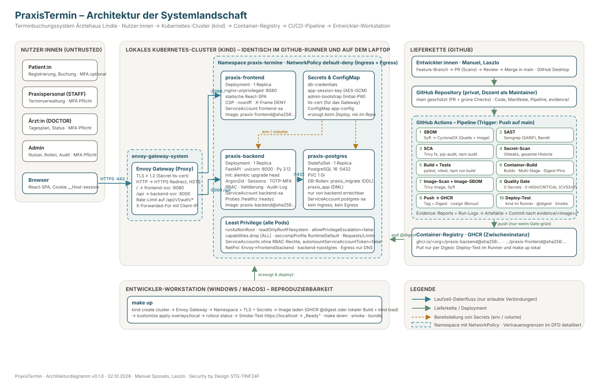

# Architekturentscheidung – PraxisTermin

> Terminbuchungssystem für die (fiktive) **Ärztehaus Lindle**
> Prüfungsleistung Security by Design, STG-TINF24F · Team: Manuel Sposato, Laszlo
> Stand: 02.10.2026 · Version 0.1.0 (Entwurf Woche 1)

Dieses Dokument ist die verbindliche Architekturentscheidung für das Projekt. Alle
weiteren Artefakte (Threat Model, Manifeste, Pipeline, Doku) leiten sich daraus ab.
Änderungen an Entscheidungen werden in Abschnitt 10 nachgetragen, damit die
Konsistenz zwischen Architektur und Umsetzung (Bewertungskriterium) belegbar bleibt.

---

## 1. Ziel und Scope

**Ziel:** Eine kleine, vollständige Webanwendung, mit der Patient:innen online Termine
bei einer Hausarztpraxis buchen, einsehen und stornieren können und mit der das
Praxisteam Termine, Verfügbarkeiten und Nutzer:innen verwaltet. Der Schwerpunkt liegt
nicht auf Funktionsumfang, sondern auf **Security by Design** und einer
**nachvollziehbaren, reproduzierbaren Lieferkette** bis zum Deployment auf ein
lokales Kubernetes-Cluster.

**Im Scope (MVP):**

| Bereich | Funktion |
|---|---|
| Patient:in | Registrierung, Login (optional MFA), Buchungsflow (Leistung → Ärzt:in → Termin → Bestätigung), eigene Termine einsehen und stornieren, eigene Stammdaten pflegen |
| Praxispersonal | Alle Termine einsehen/anlegen/verschieben/stornieren, Verfügbarkeiten (Slots) pflegen, Patient:innen suchen |
| Ärzt:in | Eigenen Tagesplan einsehen, Termin als „wahrgenommen / nicht erschienen“ markieren |
| Admin | Nutzer:innen und Rollen verwalten, Ärzt:innen und Leistungen pflegen, Audit-Log einsehen |
| System | Admin-Bootstrap beim ersten Start, Audit-Logging, Health-Endpunkte |

**Nicht im Scope (bewusst, siehe Abschnitt 11):** E-Mail-/SMS-Versand, Videosprechstunde,
Abrechnung, Anbindung an Praxisverwaltungssysteme, Mehrmandantenfähigkeit, Internet-Exposition.

---

## 2. Rollen und Berechtigungskonzept

Vier Rollen, serverseitig durchgesetzt (RBAC) plus objektbezogene Prüfung
(Patient:in darf nur eigene Ressourcen sehen, Ärzt:in nur eigene Termine).

| Aktion | PATIENT | STAFF | DOCTOR | ADMIN |
|---|:-:|:-:|:-:|:-:|
| Registrieren / eigenes Profil pflegen | ✔ | ✔ | ✔ | ✔ |
| Freie Slots sehen, Termin buchen (für sich) | ✔ | ✔ (für Patient:in) | – | – |
| Eigene Termine sehen / stornieren | ✔ | – | – | – |
| Alle Termine sehen / ändern / stornieren | – | ✔ | nur eigene | ✔ |
| Terminstatus setzen (wahrgenommen / no-show) | – | ✔ | nur eigene | ✔ |
| Verfügbarkeiten (Slots) pflegen | – | ✔ | nur eigene | ✔ |
| Patient:innen suchen (Name, Geburtsdatum) | – | ✔ | ✔ | ✔ |
| Ärzt:innen / Leistungen pflegen | – | – | – | ✔ |
| Nutzer:innen anlegen, Rollen ändern, sperren | – | – | – | ✔ |
| Audit-Log einsehen | – | – | – | ✔ |
| MFA (TOTP) | optional | **Pflicht** | **Pflicht** | **Pflicht** |

**Admin-Bootstrap („Der erste Login eines Users soll der Admin sein“):**
Beim ersten Start prüft das Backend, ob Nutzer:innen existieren. Falls nicht, wird genau
ein Admin-Konto angelegt. Das Initialpasswort stammt aus einem Kubernetes-Secret, das
`make up` bzw. die Pipeline zufällig erzeugt (nicht im Repository). Der erste Login
erzwingt Passwortwechsel und MFA-Einrichtung, bevor andere Funktionen freigeschaltet
werden. Weitere Praxis-Konten (STAFF/DOCTOR) legt ausschließlich der Admin an.
Selbstregistrierung erzeugt immer die Rolle PATIENT.

---

## 3. Tech-Stack

| Schicht | Technologie | Begründung |
|---|---|---|
| Frontend | React 19 + TypeScript, Vite, Tailwind CSS v4, shadcn/ui (Radix-Primitives), React Router, TanStack Query, react-hook-form + zod | Wenig Eigencode durch fertige, barrierefreie Komponenten; zod-Schemas spiegeln die Backend-Validierung; statischer Build ohne Server-Logik |
| Frontend-Auslieferung | `nginxinc/nginx-unprivileged` (Port 8080) | Läuft ohne Root, setzt Security-Header und CSP, minimale Angriffsfläche |
| Backend | Python 3.14, FastAPI, Pydantic v2, SQLAlchemy 2.x, Alembic, uvicorn | Strikte Schema-Validierung out of the box, OpenAPI-Dokumentation, gutes Security-Tooling (Bandit, Semgrep, pip-audit), vorhandene Python-Erfahrung im Team |
| Auth | Argon2id (`argon2-cffi`), serverseitige Sessions (opaker Token, gehasht in DB), HttpOnly-Cookie, TOTP-MFA (`pyotp`) | Kein JWT-Algorithmus-Verwirrungsrisiko, Sitzungen jederzeit serverseitig widerrufbar, MFA ohne externe Dienste |
| Datenbank | PostgreSQL 16 (offizielles Image, non-root), StatefulSet + PVC | Realistische Trennung in eigene Komponente, eigene Vertrauensgrenze, saubere NetworkPolicy-Demonstration |
| Container | Multi-Stage-Dockerfiles, Basis-Images per Digest gepinnt (Backend: `python:3.14-alpine`), non-root (UID 10001), `readOnlyRootFilesystem`, Abhängigkeiten nur mit Hash-Prüfung | Reproduzierbare Builds, Supply-Chain-Härtung |
| Orchestrierung | Kubernetes via **kind** (lokal und im CI-Runner), ingress-nginx, Kustomize (base + overlays `local`/`ci`) | kind läuft identisch in GitHub Actions und auf dem Laptop; Kustomize ohne Templating-Sprache ist leichter zu reviewen als Helm |
| CI/CD | GitHub Actions | Repo liegt auf GitHub; Marketplace-Actions für alle Scanner |
| Registry | GitHub Container Registry (GHCR) | Zwischeninstanz laut Aufgabe; Zugriff mit `GITHUB_TOKEN` ohne weitere Secrets |
| SBOM | Syft → CycloneDX JSON (Quellcode + Image) | Standardformat, von Trivy/Grype weiterverarbeitbar |
| SAST | Semgrep (p/owasp-top-ten, p/python, p/typescript, p/react), Bandit | Abdeckung beider Sprachen, SARIF-Export |
| SCA | Trivy (fs + image), pip-audit, npm audit | CVSS-basierte Bewertung, Quality Gate auf HIGH/CRITICAL |
| Secret-Scan | Gitleaks (gesamte Historie) | Gate: Abbruch bei jedem Fund |
| Signatur (Bonus) | cosign keyless (Sigstore) | Image-Herkunft nachweisbar, optional |
| Build-Blaupause | GNU Make (`make up`) | Von der Aufgabe gefordert; Ausführung unter Linux, macOS oder WSL2 (siehe A14) |

---

## 4. Systemlandschaft

Das Architekturdiagramm liegt unter `docs/diagrams/architektur.svg`
(Quelle: `architektur.mmd` als Mermaid). Es bildet die komplette Landschaft ab:
Nutzer:innen → Ingress → Frontend/Backend/DB im Cluster → Registry → CI/CD-Pipeline →
Entwickler-Workstation mit `make up`.



### 4.1 Beschreibung aller Komponenten

| # | Komponente | Aufgabe | Sicherheitsrelevante Eigenschaften |
|---|---|---|---|
| 1 | **Browser (Patient:in, Personal, Ärzt:in, Admin)** | Bedient die React-SPA | Außerhalb jeder Vertrauensgrenze; alle Eingaben gelten als feindlich |
| 2 | **Ingress-NGINX Controller** (Namespace `ingress-nginx`) | Einziger Eintrittspunkt in den Cluster, TLS-Terminierung, Routing `/` → frontend, `/api` → backend | TLS-Zertifikat als Secret (lokal selbstsigniert), Request-Größenlimit, Rate-Limit-Annotation auf `/api/auth/*` |
| 3 | **Frontend-Deployment** (`praxis-frontend`) | Liefert die statische SPA aus | nginx-unprivileged, Port 8080, CSP ohne `unsafe-inline`, HSTS, `X-Frame-Options: DENY`, `readOnlyRootFilesystem` mit emptyDir für Cache/PID |
| 4 | **Backend-Deployment** (`praxis-backend`) | REST-API, Auth, RBAC, Fachlogik, Audit-Log | Pydantic-Validierung, generische Fehlerantworten, Argon2id, Sessions, TOTP, Rate-Limit, kein Root, Secrets nur per Env/Volume |
| 5 | **Init-Container `migrate`** | Führt `alembic upgrade head` vor dem Start aus | Gleiches Image wie Backend, eigenes DB-Konto mit DDL-Rechten nur hier; Backend-Laufzeitkonto hat nur DML |
| 6 | **PostgreSQL StatefulSet** (`praxis-postgres`) | Persistenz | Nur von Backend-Pods erreichbar (NetworkPolicy), Passwort aus Secret, PVC, non-root, kein Ingress |
| 7 | **Secrets / ConfigMap** | `db-credentials`, `app-session-key`, `admin-bootstrap`, `tls-cert`; `app-config` | Zur Deploy-Zeit erzeugt (Makefile / Pipeline), nie im Repo; nur an die Pods gemountet, die sie brauchen |
| 8 | **ServiceAccounts** `frontend-sa`, `backend-sa`, `postgres-sa` | Identität der Pods | Keine RBAC-Rechte, `automountServiceAccountToken: false` |
| 9 | **NetworkPolicies** | Mikrosegmentierung im Namespace | `default-deny-all` (Ingress + Egress), Allow-Regeln: Ingress-Controller → frontend/backend, backend → postgres:5432, Egress DNS |
| 10 | **GitHub Repository (privat)** | Quellcode, Manifeste, Pipeline, Evidence | Branch Protection auf `main` (PR + grüne Checks), keine Secrets im Repo |
| 11 | **GitHub Actions Pipeline** | SBOM → SAST → SCA → Secret-Scan → Build → Image-Scan → Quality Gate → Push → Deploy-Test → Evidence | Minimale Token-Permissions pro Job, gepinnte Actions (SHA), Reports als Artefakte + Commit nach `/evidence` |
| 12 | **GHCR (Container-Registry)** | Zwischeninstanz zwischen Pipeline und Cluster | Images per Digest referenziert, optional cosign-signiert |
| 13 | **Deploy-Test (kind im Runner)** | Beweist, dass das gebaute Image mit den Manifesten startet | Pull per Digest aus GHCR, `kubectl rollout status`, Smoke-Test über Ingress |
| 14 | **Entwickler-Workstation** | `make up` reproduziert den Deploy-Test lokal | Gleiche Manifeste (Overlay `local`), Secrets lokal erzeugt |

---

## 5. Laufzeitarchitektur im Cluster

```
Namespace ingress-nginx                 Namespace praxis-termine (NetworkPolicy: default deny)
+-------------------------+             +------------------------------------------------------+
| ingress-nginx-controller|---:8080---> | Deployment praxis-frontend  (1 Replica, nginx-unpriv.)|
|  TLS :443 / HTTP :80    |             |                                                      |
|  /     -> frontend-svc  |---:8000---> | Deployment praxis-backend   (1 Replica, FastAPI)     |
|  /api  -> backend-svc   |             |   init: migrate (alembic)                            |
+-------------------------+             |        | :5432                                       |
                                        |        v                                             |
                                        | StatefulSet praxis-postgres (1 Replica) -- PVC 1Gi   |
                                        | Secrets: db-credentials, app-session-key,            |
                                        |          admin-bootstrap · ConfigMap: app-config     |
                                        +------------------------------------------------------+
```

**Netzwerkflüsse (nur diese sind erlaubt):**

| Von | Nach | Port | Zweck |
|---|---|---|---|
| Browser | Ingress | 443/TCP | HTTPS |
| ingress-nginx | praxis-frontend | 8080/TCP | SPA ausliefern |
| ingress-nginx | praxis-backend | 8000/TCP | REST-API unter `/api` |
| praxis-backend | praxis-postgres | 5432/TCP | Datenbank |
| alle Pods | kube-dns | 53/UDP+TCP | Namensauflösung |

Das Frontend spricht **nie** direkt mit dem Backend-Pod, sondern der Browser ruft `/api`
über denselben Ingress-Host auf (Same-Origin, keine CORS-Freigaben nötig).

**Ressourcen:** Requests/Limits für CPU und RAM auf allen Containern, Liveness/Readiness-Probes
(`/healthz`, `/readyz`), PodDisruptionBudget nicht nötig (Einzelreplica, lokales Cluster).

---

## 6. Authentifizierung, Sitzungen, MFA

1. **Passwörter:** Argon2id (time=3, memory=64 MiB, parallelism=4), Mindestlänge 12 Zeichen,
   Maximallänge 128, Abgleich gegen Liste häufiger Passwörter (Top 10k, lokal im Image).
2. **Login:** `POST /api/v1/auth/login` → bei Erfolg und aktivierter MFA: Zwischenzustand
   `mfa_pending` (eigenes kurzlebiges Cookie, 5 min), dann `POST /api/v1/auth/mfa/verify`
   mit 6-stelligem TOTP (±1 Zeitschritt). Fehlermeldung immer identisch
   („E-Mail oder Passwort ungültig“), gleiche Antwortzeit durch Dummy-Hash bei unbekannter E-Mail.
3. **Sitzung:** 256-Bit-Zufallstoken, in der DB nur als SHA-256-Hash gespeichert;
   Cookie `__Host-session` mit `HttpOnly; Secure; SameSite=Strict; Path=/`.
   Leerlauf-Timeout 30 min, absolutes Limit 8 h, Rotation nach Login/MFA/Passwortwechsel,
   Logout invalidiert serverseitig. Alle Sitzungen eines Kontos widerrufbar (Admin, Passwortwechsel).
4. **CSRF:** SameSite=Strict plus Origin/Referer-Prüfung auf allen zustandsändernden Requests.
5. **Brute-Force-Schutz:** Zähler pro Konto und pro IP (in DB), nach 10 Fehlversuchen 15 min Sperre,
   Ingress-Rate-Limit zusätzlich auf `/api/v1/auth/*`.
6. **MFA (TOTP, RFC 6238):** Secret pro Nutzer:in, verschlüsselt mit `app-session-key` (AES-GCM)
   in der DB; Einrichtung per QR-Code (otpauth-URI), 8 Recovery-Codes (gehasht); Pflicht für
   STAFF/DOCTOR/ADMIN, optional für PATIENT.
7. **Audit-Log:** Login/Logout/Fehlversuch/Sperre, MFA-Änderungen, Rollenänderungen,
   Terminänderungen durch Personal; Felder: Zeit, Akteur-ID, Aktion, Ziel-ID, Request-ID, IP.
   Keine Passwörter, keine Freitexte, keine Gesundheitsdaten.

---

## 7. Datenmodell (Entwurf)

| Entität | Wichtige Felder | Hinweise |
|---|---|---|
| `users` | id (UUID), email (unique, lowercase), password_hash, role, is_active, must_change_password, mfa_enabled, mfa_secret_enc, failed_logins, locked_until, created_at | Keine Gesundheitsdaten |
| `patients` | user_id (FK), first_name, last_name, birth_date, phone, insurance_type (GKV/PKV/SELBSTZAHLER) | Datensparsam, kein Freitext |
| `doctors` | id, user_id (FK, optional), display_name, title, specialty, is_active | |
| `services` | id, name, duration_min, description, is_active | z. B. „Hausarztsprechstunde 15 min“ |
| `availability_slots` | id, doctor_id, start_at, end_at, is_booked | Von STAFF/DOCTOR gepflegt |
| `appointments` | id, patient_id, doctor_id, service_id, slot_id, status (BOOKED/CANCELLED/DONE/NO_SHOW), note (max 200 Zeichen), created_by, created_at | Note ohne HTML, serverseitig gekürzt |
| `sessions` | id, user_id, token_hash, created_at, last_seen_at, expires_at, mfa_verified, ip, user_agent_hash | |
| `recovery_codes` | user_id, code_hash, used_at | |
| `audit_log` | id, ts, actor_id, action, target_type, target_id, request_id, ip, outcome | Append-only (nur INSERT-Recht für Laufzeitkonto) |

Zwei DB-Rollen: `praxis_migrate` (DDL, nur Init-Container) und `praxis_app` (DML, kein DROP/ALTER,
auf `audit_log` nur INSERT/SELECT).

---

## 8. API-Übersicht

Alle Endpunkte unter `/api/v1`, JSON, Fehlerschema
`{ "error": { "code": "...", "message": "...", "request_id": "..." } }`.

| Methode & Pfad | Rolle | Zweck |
|---|---|---|
| `POST /auth/register` | – | Patient:in registrieren |
| `POST /auth/login` · `POST /auth/mfa/verify` · `POST /auth/logout` | – / Sitzung | Login-Flow |
| `GET /auth/me` · `POST /auth/password` | Sitzung | Eigene Identität, Passwortwechsel |
| `POST /auth/mfa/setup` · `POST /auth/mfa/confirm` · `DELETE /auth/mfa` | Sitzung | MFA verwalten |
| `GET /services` · `GET /doctors` | – | Stammdaten für den Buchungsflow |
| `GET /slots?doctor_id&from&to` | – | Freie Slots |
| `POST /appointments` · `GET /appointments/me` · `DELETE /appointments/{id}` | PATIENT | Buchen, eigene Termine, stornieren |
| `GET /staff/appointments` · `POST /staff/appointments` · `PATCH /staff/appointments/{id}` | STAFF, ADMIN | Terminverwaltung |
| `GET /staff/patients?q=` | STAFF, DOCTOR, ADMIN | Patientensuche |
| `GET/POST/DELETE /staff/slots` | STAFF, DOCTOR (eigene), ADMIN | Verfügbarkeiten |
| `GET /doctor/schedule?date` · `PATCH /doctor/appointments/{id}/status` | DOCTOR | Tagesplan, Status |
| `GET/POST/PATCH /admin/users` · `GET/POST/PATCH /admin/doctors` · `GET/POST/PATCH /admin/services` | ADMIN | Verwaltung |
| `GET /admin/audit` | ADMIN | Audit-Log |
| `GET /healthz` · `GET /readyz` | – | Probes (keine Versions-/Stack-Infos); zusätzlich unter `/api/v1/` für den Smoke-Test über den Ingress |

OpenAPI-UI (`/docs`) ist nur im Entwicklungsmodus aktiv, im Cluster deaktiviert.

---

## 9. Lieferkette (CI/CD)

Trigger: Push/Merge auf `main` (volle Pipeline inkl. Push und Deploy-Test) sowie Pull Requests
(alle Scans und Gates, kein Push, kein Deploy). Je Image (`backend`, `frontend`) ein eigener
Evidence-Ordner.

| Stufe | Werkzeug | Ergebnis / Gate |
|---|---|---|
| 1 SBOM (Quelle) | Syft → CycloneDX JSON | `evidence//sbom/<run>-source.cdx.json` |
| 2 SAST | Semgrep (SARIF), Bandit (JSON) | `evidence//sast/`; Gate: keine Findings mit Severity ERROR/HIGH |
| 3 SCA | Trivy fs, pip-audit / npm audit | `evidence//sca/`; **Gate: Abbruch bei CVSS ≥ 7.0 bzw. HIGH/CRITICAL** |
| 4 Secret-Scan | Gitleaks (gesamte Historie) | `evidence//secrets/`; **Gate: Abbruch bei jedem Fund** |
| 5 Build | `npm run build`, `pip install` + Tests (pytest, vitest) | Unit-Tests müssen grün sein |
| 6 Container-Build | Docker Buildx, Multi-Stage, Basis-Images per Digest | Image-Tag `<version>-<sha>` |
| 7 Image-Scan + Image-SBOM | Trivy image, Syft | Gleiche Gates wie 3; SBOM des finalen Images |
| 8 Quality Gate | Skript `scripts/quality-gate.py` aggregiert alle Reports | Fail → Pipeline bricht ab, kein Push |
| 9 Push | GHCR, Digest wird ausgegeben; cosign keyless (Bonus) | `image-ref.txt`, `digest.txt` |
| 10 Deploy-Test | kind im Runner, ingress-nginx, Overlay `ci`, Image per Digest | `kubectl rollout status`, Smoke-Test `GET /healthz` + Login-Seite über Ingress |
| 11 Evidence | Run-Log + alle Reports | Upload als Artefakt und Commit nach `/evidence/**` (`[skip ci]`) |

**Deployment lokal:** `make up` führt dieselben Schritte aus wie Stufe 10 (siehe `Makefile`),
lädt das Image per Digest aus GHCR (oder baut es lokal und lädt es mit `kind load`),
wendet `infrastructure/k8s/overlays/local` an, wartet auf Health und gibt `Ready` aus.

---

## 10. Entscheidungen und Alternativen (ADR-Kurzform)

| # | Entscheidung | Verworfene Alternativen | Begründung |
|---|---|---|---|
| A1 | FastAPI (Python) im Backend | NestJS, Spring Boot, Go | Minimaler Boilerplate, Validierung integriert, Python-Erfahrung, sehr gute SAST/SCA-Werkzeuge |
| A2 | React + Vite + shadcn/ui im Frontend | Server-Side-Templates (Jinja), Astro, Next.js | Fertige barrierefreie Komponenten reduzieren Eigencode; SPA ist statisch und braucht keinen Node-Server im Cluster |
| A3 | Getrennte Images für Frontend und Backend | Ein kombiniertes Image | Klare Vertrauensgrenzen, kleinere Angriffsfläche je Container, zwei Evidence-Ordner wie in der Aufgabe vorgesehen |
| A4 | PostgreSQL als eigene Komponente | SQLite im Backend-Container | Echte Netzwerk-Vertrauensgrenze, NetworkPolicy und Secret-Handling werden sichtbar; realistischer |
| A5 | Serverseitige Sessions statt JWT | JWT in Cookie/Header | Sofortiger Widerruf, kein Signatur-/Algorithmus-Risiko, kleinere Angriffsfläche |
| A6 | Deploy-Test mit kind im GitHub-Runner + `make up` lokal | Self-hosted Runner, nur Registry-Push | Vollautomatisch ohne dauerhaft laufenden Rechner; Pipeline deployt nachweislich über die Registry; lokal identisch reproduzierbar |
| A7 | Kustomize statt Helm | Helm-Chart | Reine YAML-Manifeste, leichter zu reviewen und zu scannen (kube-linter/Trivy config), kein Templating-Fehlerpotenzial |
| A8 | GHCR als Registry | Docker Hub, lokale Registry im Cluster | Keine zusätzlichen Credentials (`GITHUB_TOKEN`), Digest-Referenzen, Paket-Sichtbarkeit steuerbar |
| A9 | Secrets zur Deploy-Zeit generieren | Sealed Secrets, SOPS, Vault | Für ein lokales Cluster ausreichend und ohne weitere Infrastruktur; keine Secrets im Repo; in der Doku als Abweichung reflektiert |
| A10 | TLS mit selbstsigniertem Zertifikat am Ingress | cert-manager mit Let's Encrypt | Kein öffentlicher Hostname vorhanden; HSTS/Secure-Cookies trotzdem demonstrierbar |
| A11 | MFA per TOTP | WebAuthn/Passkeys, SMS | Ohne externe Dienste umsetzbar, +10 Bonuspunkte, Standard-Apps nutzbar |
| A12 | Python 3.14 statt 3.12 (19.10.2026) | Python 3.12 | Aktuelle stabile Version, lokal installiert, alle Abhängigkeiten haben Wheels; längerer Support-Zeitraum |
| A13 | Backend-Basis-Image `python:3.14-alpine` statt `python:3.14-slim` (19.10.2026) | Debian-slim, Distroless, Chainguard | slim enthielt 44 HIGH-CVEs in Systempaketen (util-linux, ncurses, perl) ohne verfügbaren Fix und hätte das Quality Gate dauerhaft blockiert; Alpine: 0 HIGH/CRITICAL, 100 MB kleiner, Shell für Healthcheck vorhanden |
| A14 | `make up` unter Linux/macOS/WSL2 (19.10.2026) | Native Windows-Ausführung | Die Windows-„Intelligente App-Steuerung“ blockiert unsignierte Binärdateien (`make.exe`, `kind.exe`, kompilierte Python-Erweiterungen); WSL2 ist ohnehin die Docker-Desktop-Basis und entspricht der Linux-Umgebung der Pipeline |
| A15 | Sync-SQLAlchemy mit psycopg 3, Lockfiles mit Hashes via `uv pip compile --universal` | async SQLAlchemy, Poetry | Einfacher, für die Last ausreichend; Hash-Pinning schützt vor manipulierten Paketen (Supply Chain) |

---

## 11. Bewusste Abweichungen und nicht-sichere Teile (mit Begründung)

| Punkt | Entscheidung | Begründung / Risiko |
|---|---|---|
| Kein E-Mail-Versand (Verifizierung, Terminbestätigung, Passwort-Reset) | Nicht umgesetzt; Passwort-Reset nur durch Admin | Kein SMTP-Dienst im lokalen Cluster; Egress bewusst auf DNS beschränkt. Risiko: Konten mit fremder E-Mail-Adresse; begrenzt, da E-Mail nur Login-Name ist |
| Selbstsigniertes TLS-Zertifikat | Akzeptiert | Lokales Cluster ohne öffentliche Domain; im Browser muss das Zertifikat einmalig akzeptiert werden |
| Keine Verschlüsselung der Datenbank-Dateien (at rest) | Akzeptiert | kind-PVC auf lokaler Platte; wäre im Produktivbetrieb über Storage-Klasse zu lösen |
| Postgres-Zugangsdaten als Kubernetes-Secret (base64) | Akzeptiert | Kein externer Secret-Manager vorhanden; etcd-Verschlüsselung ist Cluster-Thema, nicht App-Thema |
| Ein Replica je Komponente | Akzeptiert | Verfügbarkeit ist kein Prüfungsziel; spart Ressourcen im Runner |
| OpenAPI-UI im Cluster deaktiviert | Härtung | Keine Endpunkt-Enumeration für Angreifer:innen |

Diese Liste wird während des Projekts fortgeschrieben und in Kapitel „Nicht-sichere Parts“
der Abschlussdokumentation übernommen.

---

## 12. Offene Punkte (Woche 1)

- [ ] GitHub-Repository anlegen (privat), Dozent als Maintainer eintragen, Branch Protection auf `main`
- [ ] GHCR-Paket-Sichtbarkeit festlegen (öffentlich = kein Pull-Secret nötig; privat = Pull-Secret via Makefile)
- [x] Praxisname bestätigt: „Ärztehaus Lindle“ (07.10.2026)
- [x] Toolchain lokal installieren (Manuel, 19.10.2026: Python 3.14, Docker, trivy; make/kind in WSL nachziehen)
